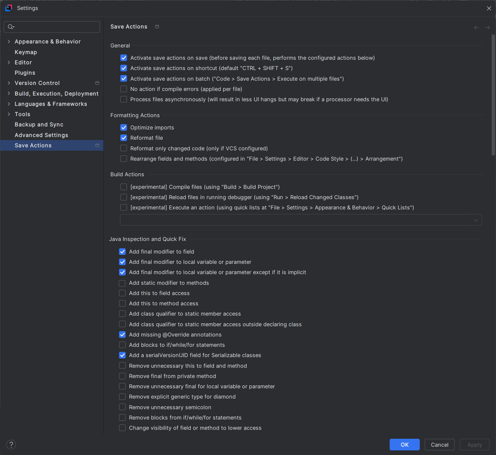
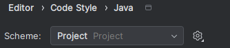

This command line tool generates html preview files of DiagnosticReport bundles as documented on https://build.fhir.org/ig/hl7-be/hl7-be-fhir-laboratory-report/.

## Usage

To compile the CLI type `mvn package`

To run the CLI and get some help message, type `java -jar target/fhir-visualization-tool-1.0-SNAPSHOT-jar-with-dependencies.jar`

To execute the CLI on some test FHIR file, type `java -jar target/fhir-visualization-tool-1.0-SNAPSHOT-jar-with-dependencies.jar html src/test/resources/example.json` or
`java -jar target/fhir-visualization-tool-1.0-SNAPSHOT-jar-with-dependencies.jar embed src/test/resources/example.json`

To execute the CLI on some test FHIR file, type `java -jar target/fhir-visualization-tool-1.0-SNAPSHOT-jar-with-dependencies.jar html src/test/resources/example.json` or
`java -jar target/fhir-visualization-tool-1.0-SNAPSHOT-jar-with-dependencies.jar embed src/test/resources/example.json`

To directly open the generated html preview in a browser, use:
` java -jar target/fhir-visualization-tool-1.0-SNAPSHOT-jar-with-dependencies.jar -d html src/test/resources/example.json`

To extract the narratives from the CLI on some test FHIR file, type
`java -jar target/fhir-visualization-tool-1.0-SNAPSHOT-jar-with-dependencies.jar html src/test/resources/example.json` or
`java -jar target/fhir-visualization-tool-1.0-SNAPSHOT-jar-with-dependencies.jar extract src/test/resources/example.json`

# Formating Code

## Configuring Save action

Install plugin : https://plugins.jetbrains.com/plugin/22113-save-actions-x

Congifuration plugin 

## Code Formatting

Configuration :

- Setting
- Editor > Code Style > Java
- select Project for the scheme 